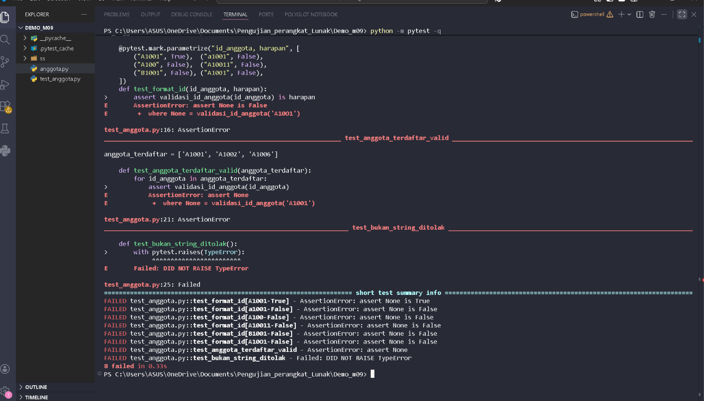
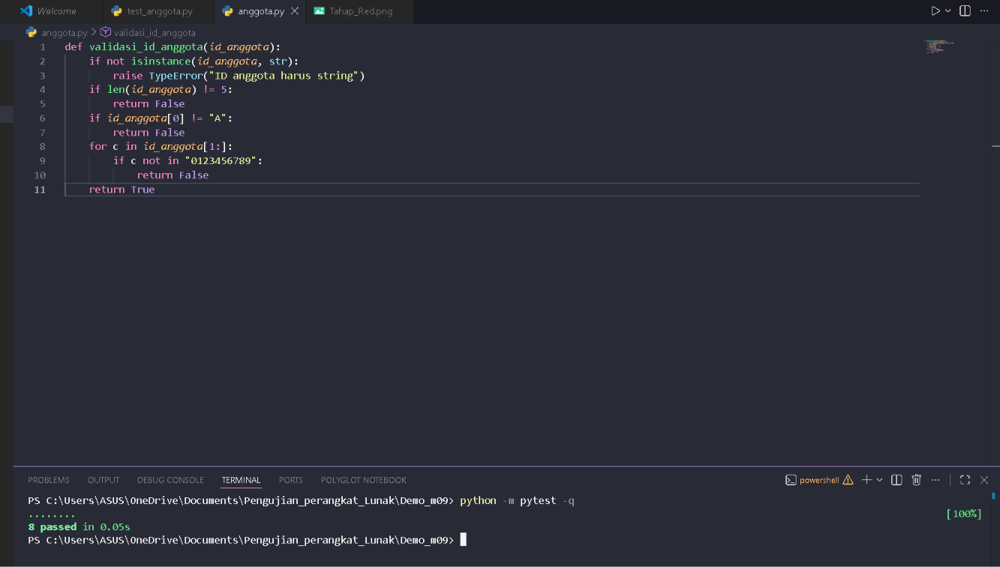
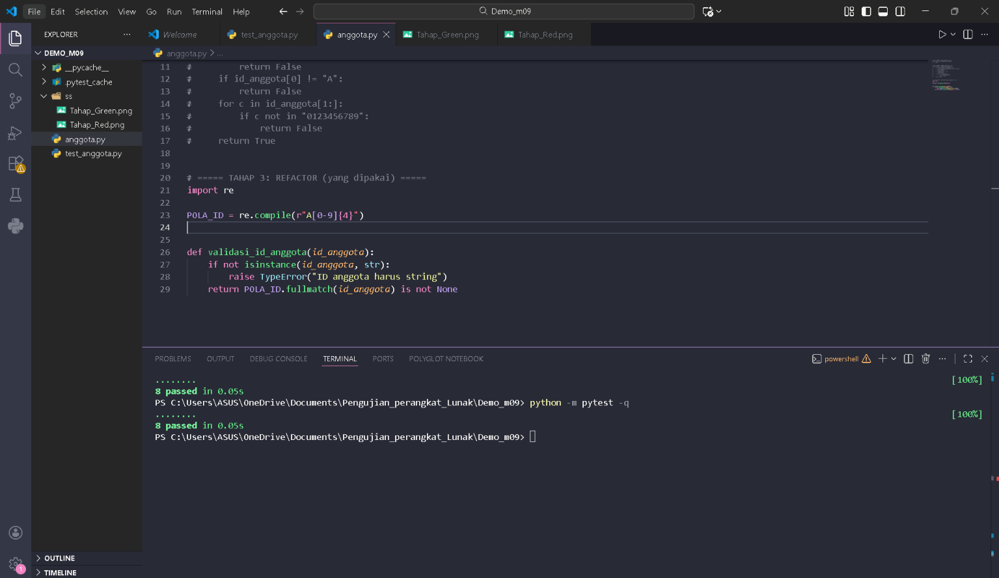

# Demo TDD: validasi_id_anggota

Demo Unit Testing dan Test-Driven Development (Red, Green, Refactor)
untuk mata kuliah Pengujian Perangkat Lunak, Pertemuan 9.
Studi kasus: PustakaKita.

## Aturan fungsi

- ID anggota valid: huruf **A** kapital diikuti tepat **empat angka**, misalnya `A1001`
- selain itu mengembalikan `False`
- input yang bukan string melempar `TypeError`

## Struktur folder

```
Demo_m09
├── anggota.py          # fungsi validasi_id_anggota (tahap Red, Green, Refactor)
├── test_anggota.py     # 8 test dengan pytest
├── README.md           # dokumen ini
├── ss/                 # screenshot hasil tiap tahap
│   ├── Tahap_Red.png
│   ├── Tahap_Green.png
│   └── Tahap_Refactor.png
├── .pytest_cache/      # dibuat otomatis oleh pytest
└── __pycache__/        # dibuat otomatis oleh Python
```

## Persiapan

Python 3.14 dan pytest dipasang lewat:

```powershell
python -m pip install pytest
python -m pytest --version
```

## Menjalankan test

```powershell
python -m pytest -q
```

Hasil yang diharapkan: `8 passed`.

Untuk melihat nama tiap test:

```powershell
python -m pytest -v
```

## Isi test

| Test | Fitur pytest | Yang diperiksa |
|---|---|---|
| `test_format_id` | `parametrize` (6 kasus) | format ID benar dan salah |
| `test_anggota_terdaftar_valid` | `fixture` | daftar anggota terdaftar dianggap valid |
| `test_bukan_string_ditolak` | `pytest.raises` | input bukan string melempar `TypeError` |

Total: 6 + 1 + 1 = 8 test.

## Tahap TDD

| Tahap | Isi `anggota.py` | Hasil |
|---|---|---|
| 1. Red | fungsi kosong (`pass`) | 8 failed |
| 2. Green | versi `if` dan `for` | 8 passed |
| 3. Refactor | versi regex `A[0-9]{4}` | 8 passed |

Di `anggota.py`, ketiga tahap ditulis berurutan. Tahap Red dan Green dijadikan
komentar, dan yang aktif adalah tahap Refactor.

### 1. Red: tulis test yang gagal

Fungsi belum diimplementasikan, jadi semua test gagal dan memang harus begitu.



### 2. Green: buat test lulus

Kode minimum agar semua test lulus. Belum rapi, tetapi benar.



### 3. Refactor: rapikan kode

Kode diganti memakai regex, test tidak diubah, dan tetap hijau.
Itulah tanda refactor yang aman.



## Catatan

- Berkas `.py` hanya berisi kode Python. Perintah seperti `python -m pytest -q`
  diketik di terminal, bukan di dalam berkas.
- Untuk mendemokan ulang tahap lain, pindahkan tanda `#` di `anggota.py`
  supaya hanya satu `def validasi_id_anggota` yang aktif dalam satu waktu.
- Refactor tidak mengubah test.